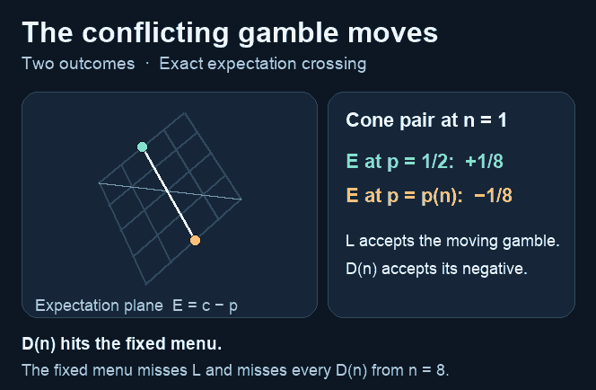

# A counterexample to combination for finite-menu representations

Pointwise cone-family combination can fail to commute with the finite-menu representation map. Two outcomes suffice. One representing family is a singleton and the other is a countable sequence omitting its lexicographic limit. [Finite-menu question](https://arthurvancamp.github.io/proceeding/smps2026/JD-SMPS2026-paper.pdf#page=8)

[Paper PDF](paper/manuscript.pdf) · [LaTeX source](paper/manuscript.tex) · [Catalog Q735](https://github.com/10m-u/open-problems-catalog/blob/ca8d4d44ba3db527f19f28928c240168f545ecfe/problems/mathematics/probability-stochastic-processes-part-1.md#q735)

## The conflicting gamble moves

For $p_n=1/2+1/(4n)$, the gamble $f_n=(c_n,c_n-1)$ with $c_n=(1/2+p_n)/2$ has expectation $1/(8n)$ at probability $1/2$ and $-1/(8n)$ at $p_n$. Each pair of cones therefore demands both $f_n$ and $-f_n$. A fixed finite menu outside the lexicographic cone instead misses the probability cones for all sufficiently large $n$.

[Download the offline explorer ZIP](https://raw.githubusercontent.com/DannyExperiments/finite-menu-combination-counterexample/v1.0.0/visualization/finite-menu-combination-counterexample-explorer.zip) · [Worked example and rendering guide](visualization/README.md)

## Scope and evidence

The source’s positive homomorphism theorem permits infinite menus. One such menu simultaneously hits all probability cones and misses the lexicographic limit in this example. Finite representing families also behave differently. Closing membership families before combination restores the equality by a compactness application of the existing finitary representation theorem. [Exact scope](CLAIM_SCOPE_AND_LIMITATIONS.md) · [Literature audit](audits/public_safe_reports/LITERATURE_AUDIT.md)

[Exact replay](REPRODUCIBILITY.md) checks the rational conflict certificates and finite-menu exclusions. The [partial Lean certificate](formal/Q735Certificate.lean) verifies the arithmetic identities and signs. The general cone and closure arguments are proved in the manuscript. Internally reviewed, not peer reviewed. [Review status](STATUS.md) · [Technical disclosure](AI_DISCLOSURE.md)

DannyExperiments is the preferred citation identity. [Release v1.0.0](https://github.com/DannyExperiments/finite-menu-combination-counterexample/releases/tag/v1.0.0) · [Version DOI](https://doi.org/10.5281/zenodo.24572493) · [Citation metadata](CITATION.cff)
