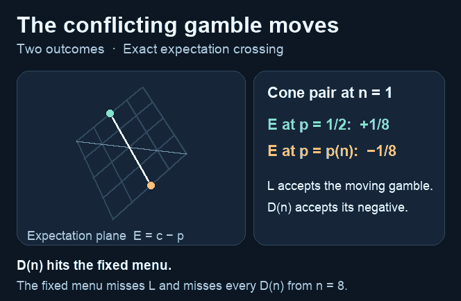

# The conflicting gamble moves

[Download the offline explorer ZIP](https://raw.githubusercontent.com/DannyExperiments/finite-menu-combination-counterexample/v1.0.0/visualization/finite-menu-combination-counterexample-explorer.zip). Extract it and open the HTML locally. Select a cone index and rotate the expectation plane.

Every point on the graph represents the gamble $(c,c-1)$ evaluated at probability $p$. Its height is $c-p$. At $c=c_n$ the segment from $p=1/2$ to $p=p_n$ crosses zero. These endpoints give the opposite expectation signs used in the [proof](../paper/manuscript.pdf).

The fixed finite menu is $\{(-17/32,15/32),(-1,-1)\}$. It misses the lexicographic cone and hits $D_n$ only for $n<8$. The infinite menu of all negated conflict gambles could hit every $D_n$, but finite menus cannot follow the moving witnesses in that way.

Render the GIF with an existing Python environment containing Pillow and Arial or DejaVu Sans.

~~~sh
python3 visualization/render.py
~~~
